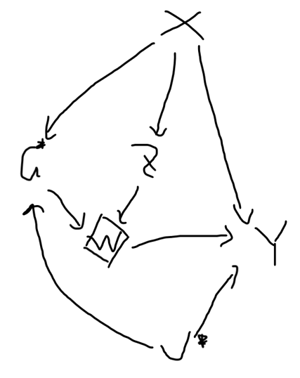

# Overall simulation setup

{width="215"}

# re-use regression coefficients for another simulation
AI todo: for each of the scenarios, generate code to represent it, and display the top 5 rows of the data using head() do not use kable.

# change the distribution of baseline covariates

# simulate data with defiers

# simulate count treatment

# simulate continuous outcome

